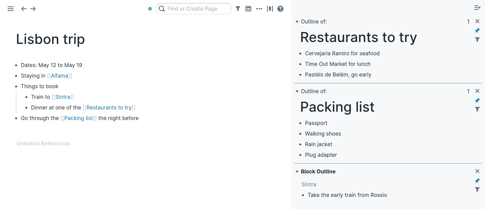
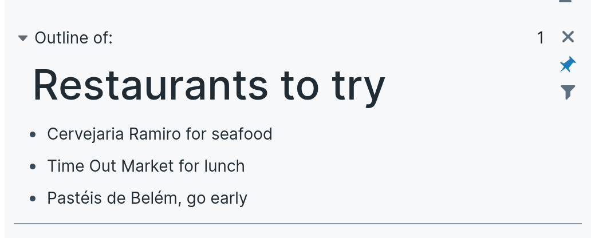

> **Successor:** [Persistent Sidebar](https://github.com/sweenzor/roam-persistent-sidebar) saves every right-sidebar window (order, collapsed, pinned) and restores it when Roam starts, without pinning anything. New work happens there.

<div align="center">

# Autopin

Everything you open in the right sidebar is pinned for you.



</div>

Roam keeps a sidebar window after you quit or reload only if you [pin](https://x.com/RoamResearch/status/1804148729617785076)
it. Autopin pins every window the moment it's opened in the right sidebar, so you never have to
click the pin yourself.

Nothing is written to your graph and nothing is sent over the network. There are no settings.

## Getting started

1. Install **Autopin** from Roam Depot.
2. Open something in the right sidebar as usual, for example by shift-clicking a page link or a bullet.

To go back to Roam's normal sidebar, turn the extension off in **Settings → Roam Depot**. Windows that are
already pinned stay pinned until you unpin them.

## Every window is pinned



The pin is the one Roam already has, beside each window in the sidebar. Autopin turns it on as the window
appears. In the picture at the top of this page, the two pages and the block were opened one after the
other, and nobody clicked a pin.

| Window | Pinned for you |
| --- | --- |
| Pages (**Outline of:**) | Yes |
| Blocks (**Block Outline**) | Yes |
| References (**References to:**) | Yes |
| Graph views (**Graph of**) | Yes |
| Searches (**Search**) | Yes |

To take one window out of the sidebar, close it with its **×** as usual.

<details>
<summary><b>How it works</b></summary>

Autopin watches the page for new sidebar windows. When one appears, it looks the window up with Roam's
sidebar API and calls Roam's own `pinWindow` on it. The result is the same as clicking the pin.

</details>

## The sidebar comes back after a restart


Roam itself keeps pinned windows. Since Autopin pins everything, the sidebar you left is there the next
time you open the graph. The picture is Roam just after it was quit and opened again.

## Limitations

- Autopin can't leave a window unpinned. Unpin one and it stays unpinned only until it's opened again.
- It keeps the sidebar by pinning, which is a workaround.
  [Persistent Sidebar](https://github.com/sweenzor/roam-persistent-sidebar) restores the sidebar without
  pinning anything, and also keeps collapsed windows and the order.

## Changes

See the [changelog](CHANGELOG.md).

## Development

```
npm install
npm run build    # webpack bundles src/index.js -> extension.js
```

Load the folder as a developer extension in **Settings → Roam Depot**.

The pictures on this page are taken in Roam's desktop app by `test/real-roam/screenshots.mjs`. The
**Screenshots** workflow runs it, commits the pictures to `docs/images` and points this page at them. Run
it before each release to Roam Depot.

## Credits

Based on the [Roam Research](https://roamresearch.com/) extension **[Workspaces](https://github.com/mlava/workspaces)**
by [Mark Lavercombe](https://github.com/mlava).

## License

[MIT](LICENSE)
